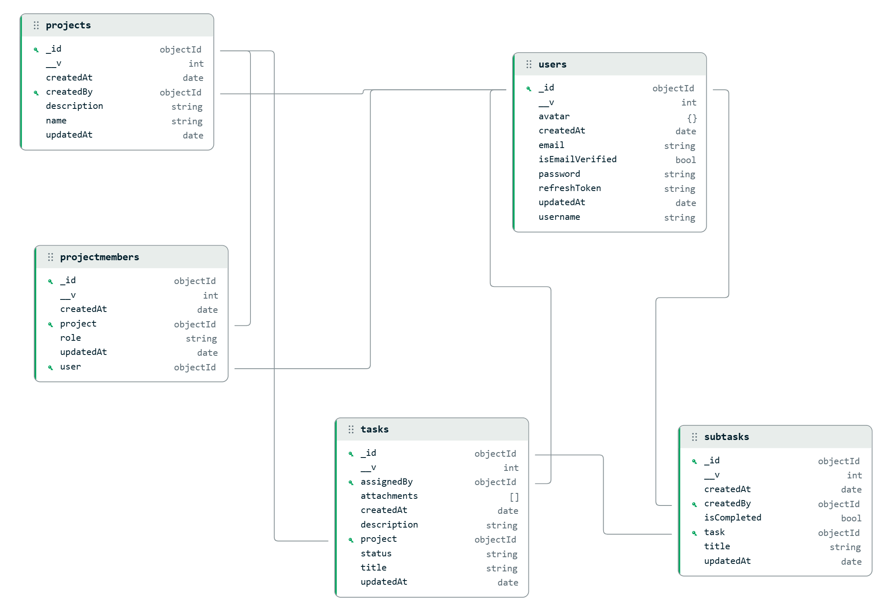

# Project Management API

> 🌐 **Live Application:** [https://project-camp-six.vercel.app/](https://project-camp-six.vercel.app/)



### What This Project Does
A collaborative project management backend (similar to Trello or Linear). It allows teams to:
* **Manage Projects:** Organize work into dedicated team workspaces.
* **Team Roles & Permissions:** Invite collaborators with granular roles (`Admin`, `Project Admin`, `Member`).
* **Task & Checklist Tracking:** Create, assign, and update tasks across workflow stages (`Todo`, `In Progress`, `Done`), with nested checklist subtasks and file attachments.
* **Project Notes:** Post shared updates and notes within each workspace.

Built with **Node.js, Express, and MongoDB Atlas**, focusing on clean data modeling, security protections, and cloud-ready rate limits.

---

## Core Architecture & Features

| # | Feature / Area | Summary | Details |
| :---: | :--- | :--- | :---: |
| **1** | **RESTful API Design** | Resource-based routes with standard HTTP status codes, consistent JSON responses, and live Swagger docs. | [Read Docs](docs/rest-api.md) |
| **2** | **Relational NoSQL Design** | Normalized 6-collection schema using a join collection (`ProjectMember`) to avoid MongoDB's 16MB document limit. | [Read Docs](docs/database-design.md) |
| **3** | **Timing Attack Defense** | Constant-time middleware with small random delays (±30ms) on auth routes so attackers cannot guess registered emails by response time. | [Read Docs](docs/timing-attack-defense.md) |
| **4** | **Stateless Auth & RBAC** | Dual-token setup (JWT Access + Refresh tokens) with role-based permissions (`admin`, `project_admin`, `member`). | [Read Docs](docs/auth-and-rbac.md) |
| **5** | **MongoDB Aggregations** | Multi-stage pipelines (`$match`, `$lookup`, `$project`, `$addFields`) to fetch full task details, assignees, and subtasks in one database query. | [Read Docs](docs/aggregation-pipelines.md) |
| **6** | **Rate Limiting** | Set using 104 **Autocannon** load tests on Render—prevents Bcrypt from freezing the CPU on logins while allowing up to 120 reads per minute. | [Read Docs](docs/rate-limiting.md) |
| **7** | **Fail-Fast Validation** | Checks incoming data with `express-validator` and rejects invalid requests with 422 before controllers run. | [Read Docs](docs/validation.md) |
| **8** | **Cached DB Connection** | Reuses a single connection promise in `src/db/index.js` so simultaneous requests never open duplicate database connections. | [Read Docs](docs/db-connection-caching.md) |

---

## Tech Stack

* **Runtime:** Node.js (ES Modules)
* **Framework:** Express.js 5
* **Database:** MongoDB Atlas with Mongoose ODM
* **Security:** Bcrypt.js, JSON Web Tokens (JWT), Express-Rate-Limit, CORS, Cookie-Parser
* **Validation:** Express-Validator
* **Load Testing:** Autocannon
* **Documentation:** Swagger UI / OpenAPI 3.0

---

## Quick Start

### 1. Install Dependencies
```bash
npm install
```

### 2. Configure Environment
Create a `.env` file in the root:
```env
PORT=3000
MONGO_URI=your_mongodb_connection_string
ACCESS_TOKEN_SECRET=your_access_token_secret
ACCESS_TOKEN_EXPIRY=1d
REFRESH_TOKEN_SECRET=your_refresh_token_secret
REFRESH_TOKEN_EXPIRY=10d
CORS_ORIGIN=http://localhost:3000
```

### 3. Run Locally
```bash
# Development (with nodemon)
npm run dev

# Production
npm start
```

---

## Work Still Required

1. Flow of `forgot-password` (end-to-end email delivery and reset token flow)
