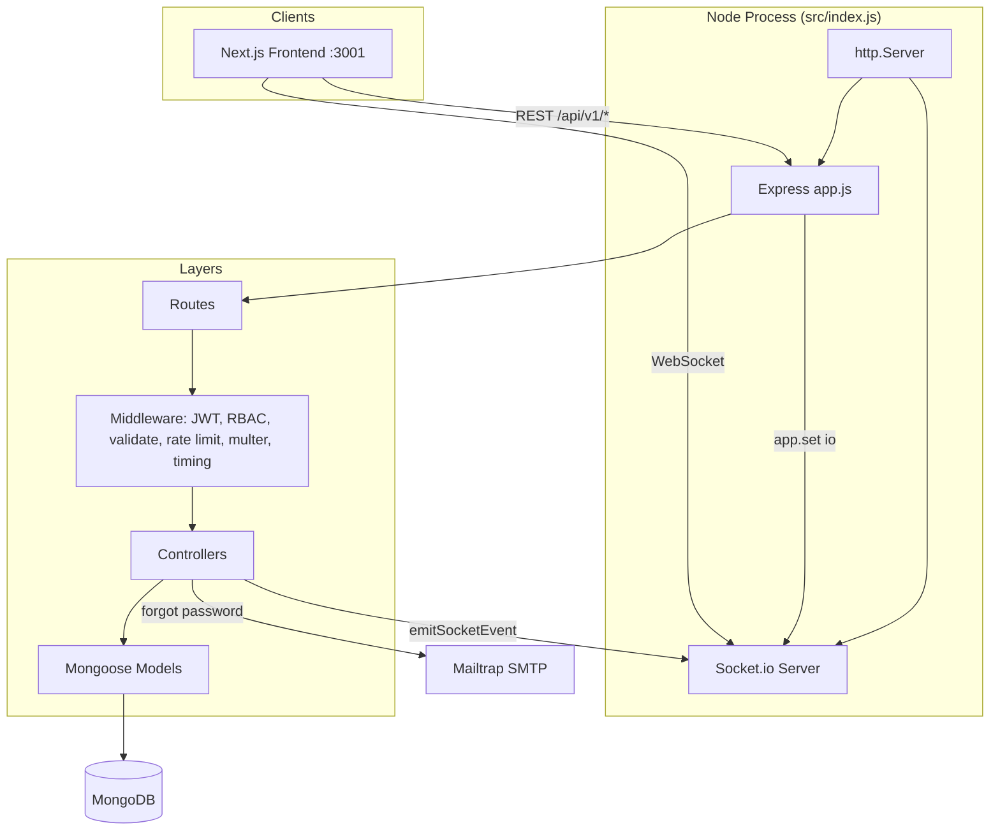
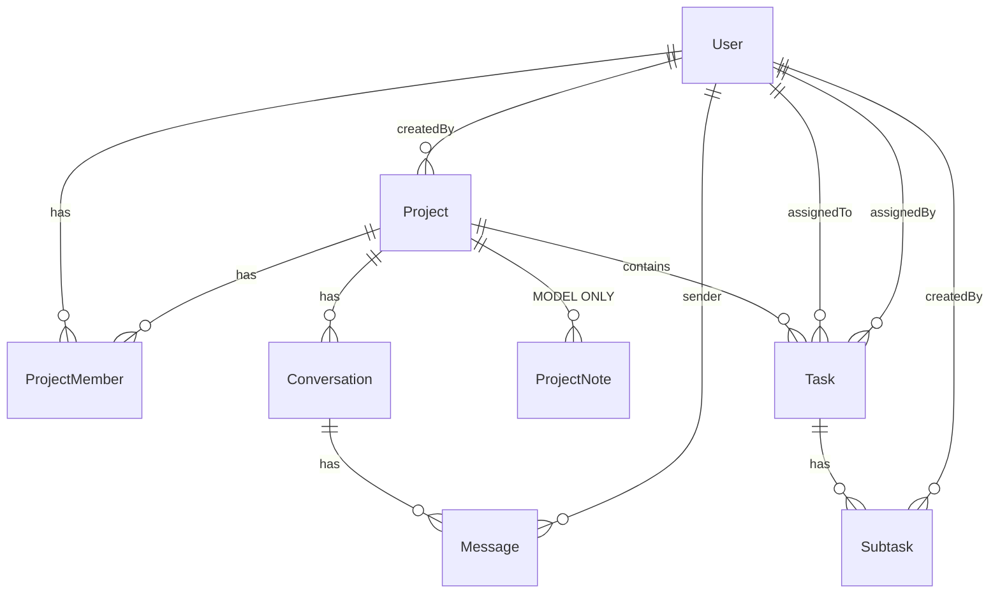

# Backend Architecture — Project Camp API

> **Scope:** `project_management/` (Express + MongoDB backend)  
> **Source of truth:** Implemented code under `src/`, not README/docs alone  
> **Purpose:** Persistent context for future AI coding agents integrating new features with the real architecture

---

## A. Project Overview

### Purpose

Collaborative project-management API (Trello/Linear-style): users, project workspaces, RBAC membership, tasks/subtasks, file upload hooks, password recovery email, and real-time project chat via Socket.io.

### Main features (implemented)

| Feature | Status in code |
|---|---|
| Auth (register/login/JWT refresh/logout/change password) | Implemented |
| Forgot/reset password via Mailtrap SMTP | Implemented (email failures logged, not thrown) |
| Projects CRUD + membership RBAC | Implemented |
| Tasks + subtasks CRUD | Implemented |
| Multer attachments on tasks/chat | Middleware present; **task attachments not persisted** in `createTask`/`updateTask` |
| Project default chat + messages | Implemented (`/api/v1/chat` + Socket.io) |
| Project notes (`ProjectNote`) | **Model only — no routes/controllers** |
| Swagger UI | `/docs` from `src/openapi.json` (chat endpoints **not** in OpenAPI) |

### Technology stack

- **Runtime:** Node.js, ESM (`"type": "module"`)
- **HTTP:** Express 5.1.0
- **Realtime:** Socket.io 4.8.4 on shared `http.Server`
- **DB:** MongoDB via Mongoose 8.16.5
- **Auth:** jsonwebtoken, bcryptjs, cookie-parser
- **Validation:** express-validator
- **Uploads:** multer → `./public/images`
- **Email:** nodemailer + mailgen (Mailtrap)
- **Rate limit:** express-rate-limit
- **Docs:** swagger-ui-express + `src/openapi.json`

### External dependencies / services

- MongoDB Atlas (or any Mongo via `MONGO_URI`)
- Frontend origin(s) via `CORS_ORIGIN` (default intended: `http://localhost:3001`)
- Production host referenced in OpenAPI: `https://project-management-1-x0rd.onrender.com/`
- Live frontend (README): `https://project-camp-six.vercel.app/`

### Package entry

- `npm run dev` → `nodemon src/index.js`
- `npm start` → `node src/index.js`
- **No Docker, no test runner scripts, no CI config in this package**

---

## B. System Architecture

### Pattern actually used

**Layered MVC-style monolith without a service layer:**

```
HTTP/Socket → Routes → Middleware → Controllers → Mongoose Models → MongoDB
```

Controllers contain business logic and DB access. There is **no** `services/` directory.

### Major components



### Component responsibilities

| Component | Path | Responsibility |
|---|---|---|
| Bootstrap | `src/index.js` | dotenv, HTTP server, Socket.io, DB connect retry, listen |
| App wiring | `src/app.js` | Express middleware, route mounts, Swagger, global error handler |
| DB | `src/db/index.js` | Cached connection promise; DNS servers forced to 8.8.8.8 / 1.1.1.1 |
| AuthZ | `src/middlewares/auth.middleware.js` | `verifyJWT`, `validateProjectPermission`, `validateConversationMember` |
| Socket | `src/socket/index.js` + `events.js` | JWT socket auth, rooms, typing, emit helper |
| Controllers | `src/controllers/*.js` | Request handling + persistence |
| Models | `src/models/*.js` | Schemas, indexes, user token helpers |
| Utils | `src/utils/*` | `ApiError`, `ApiResponse`, `asyncHandler`, mail, enums |

### Data flow (high level)

1. Client hits `/api/v1/...`
2. Global JSON/cookie/CORS applied
3. Healthcheck is mounted **before** the global `/api` limiter
4. Route-specific limiters + validators + JWT/RBAC
5. Controller mutates/queries Mongo
6. Chat writes also broadcast via `emitSocketEvent` to Socket.io room = `conversationId`

---

## C. Folder Structure

```
project_management/
├── package.json              # deps & scripts
├── nodemon.json              # watch src/
├── README.md                 # partially outdated vs chat/notes
├── backend_architecture.md   # this document
├── docs/                     # human docs (verify against code)
│   ├── auth-and-rbac.md
│   ├── database-design.md    # omits conversations/messages; lists unused notes
│   ├── rest-api.md           # omits /chat domain
│   ├── aggregation-pipelines.md
│   ├── rate-limiting.md
│   ├── timing-attack-defense.md
│   ├── validation.md
│   └── db-connection-caching.md
└── src/
    ├── index.js              # process entry
    ├── app.js                # Express app
    ├── openapi.json          # Swagger (no chat)
    ├── db/index.js
    ├── routes/               # auth, project, task, chat, healthcheck
    ├── controllers/
    ├── models/               # user, project, projectmember, task, subtask, note, conversation, message
    ├── middlewares/
    ├── validators/index.js
    ├── socket/
    └── utils/
```

Parent monorepo uses git submodules (`.gitmodules`) for backend + frontend.

---

## D. Request Lifecycle

### Generic authenticated write

```
Client
→ express.json / cookieParser / cors
→ /api globalLimiter (600/15min)   [except healthcheck mounted before this]
→ router.use(verifyJWT)
→ readLimiter|writeLimiter|authLimiter|...
→ validateProjectPermission([...roles])   [when used]
→ express-validator + validate middleware
→ multer (optional)
→ controller (asyncHandler)
→ Model / aggregate
→ res.json(ApiResponse) OR next(ApiError) → errorHandler
```

### Cookie / Bearer dual auth

`verifyJWT` accepts:

1. `req.cookies.accessToken`, or
2. `Authorization: Bearer <token>`

---

## E. Database Architecture

### Collections (actual models)



| Collection (Mongo pluralization) | Model export | File |
|---|---|---|
| `users` | `User` | `src/models/user.models.js` |
| `projects` | `Project` | `src/models/project.models.js` |
| `projectmembers` | `ProjectMember` | `src/models/projectmember.models.js` |
| `tasks` | `Task` (+ alias `Taks`) | `src/models/task.models.js` |
| `subtasks` | `Subtask` | `src/models/subtask.models.js` |
| `projectnotes` | `ProjectNote` | `src/models/note.models.js` — **unused by API** |
| `conversations` | `Conversation` | `src/models/conversation.models.js` |
| `messages` | `Message` | `src/models/message.models.js` |

### Key schema facts

- **User:** unique `username`/`email`; bcrypt pre-save; JWT helpers; refresh + forgot-password token fields; `isEmailVerified` defaults **true** (no verification flow)
- **Project:** globally `unique` `name`; `createdBy` → User
- **ProjectMember:** `{ user, project, role }`; unique compound index `{ project, user }`
- **Task:** status enum `todo|in_progress|done`; embedded `attachments[]` (schema supports; create/update ignore uploaded files)
- **Conversation:** per-project chat; `isDefault` with **partial unique** index so only one default per project
- **Message:** `{ content, conversation, sender, attachments[] }`; index `{ conversation, createdAt: -1 }`

### Relationships style

Normalized references (`ObjectId` + `$lookup` / `.populate`), not deep embedding — except bounded arrays (attachments, avatar).

### Important query patterns

- `getProjects`: aggregate on `ProjectMember` → `$lookup` projects → member count
- `getProjectMembers`: aggregate + user `$lookup`
- `getTaskById`: aggregate task + assignedTo + nested subtasks/createdBy
- `getConversationMessages`: paginated `Message.find` sort `createdAt: -1`

### Data ownership

- Project creator becomes `admin` via `ProjectMember` on create
- Tasks belong to project; assignee optional
- Chat membership = project membership (not a separate chat-member collection)
- On `deleteProject`: deletes Conversations + Messages; **does not** delete ProjectMembers, Tasks, Subtasks, or ProjectNotes

---

## F. API Architecture

Base prefix: `/api/v1`  
Success shape: `ApiResponse` → `{ statusCode, data, message, success }`  
Error shape: `errorHandler` → `{ statusCode, message, errors, success, stack? }`

### Endpoints (from routes)

#### Health — `src/routes/healthcheck.routes.js`

| Method | Path | Auth | Handler |
|---|---|---|---|
| GET | `/api/v1/healthcheck/` | Public | `healthCheck` |

#### Auth — `src/routes/auth.routes.js` (+ `constantTimeResponse` on all)

| Method | Path | Auth | Limiter | Handler |
|---|---|---|---|---|
| POST | `/auth/register` | Public | authLimiter | `registerUser` |
| POST | `/auth/login` | Public | authLimiter | `login` |
| POST | `/auth/refresh-token` | Cookie/body refresh | sessionLimiter | `refreshAccessToken` |
| POST | `/auth/forgot-password` | Public | passwordResetLimiter | `forgotPasswordRequest` |
| POST | `/auth/reset-password/:resetToken` | Public | passwordResetLimiter | `resetForgotPassword` |
| POST | `/auth/logout` | JWT | sessionLimiter | `logoutUser` |
| POST | `/auth/current-user` | JWT | sessionLimiter | `getCurrentUser` |
| POST | `/auth/change-password` | JWT | authLimiter | `changeCurrentPassword` |

#### Projects — all require JWT — `src/routes/project.routes.js`

| Method | Path | Roles | Handler |
|---|---|---|---|
| GET | `/projects/` | JWT only | `getProjects` |
| POST | `/projects/` | JWT | `createProject` |
| GET | `/projects/:projectId` | any member | `getProjectById` |
| PUT | `/projects/:projectId` | admin | `updateProject` |
| DELETE | `/projects/:projectId` | admin | `deleteProject` |
| GET | `/projects/:projectId/members` | JWT only (**no** `validateProjectPermission`) | `getProjectMembers` |
| POST | `/projects/:projectId/members` | admin | `addMembersToProject` |
| PUT | `/projects/:projectId/members/:userId` | admin | `updateMemberRole` |
| DELETE | `/projects/:projectId/members/:userId` | admin | `deleteMember` |

#### Tasks — all JWT + project permission — `src/routes/task.routes.js`

| Method | Path | Roles | Handler |
|---|---|---|---|
| GET | `/tasks/:projectId` | any member | `getTasks` |
| POST | `/tasks/:projectId` | admin, project_admin | `createTask` (+ multer) |
| GET | `/tasks/:projectId/t/:taskId` | any member | `getTaskById` |
| PUT | `/tasks/:projectId/t/:taskId` | admin, project_admin | `updateTask` (+ multer) |
| DELETE | `/tasks/:projectId/t/:taskId` | admin, project_admin | `deleteTask` |
| POST | `/tasks/:projectId/t/:taskId/subtasks` | admin, project_admin | `createSubTask` |
| PUT | `/tasks/:projectId/st/:subTaskId` | any member | `updateSubTask` |
| DELETE | `/tasks/:projectId/st/:subTaskId` | admin, project_admin | `deleteSubTask` |

#### Chat — JWT — `src/routes/chat.routes.js`

| Method | Path | AuthZ | Handler |
|---|---|---|---|
| GET | `/chat/project/:projectId` | project member | `getProjectDefaultChat` |
| GET | `/chat/:conversationId/messages` | conversation→project member | `getConversationMessages` |
| POST | `/chat/:conversationId/messages` | same + multer + validate | `sendMessage` |

### Validation

Centralized in `src/validators/index.js`; applied via `validate` middleware (`422` on failure).

### Docs UI

- `GET /docs` — Swagger
- `GET /` — `"visit /docs"`
- OpenAPI paths omit `/api/v1` prefix and omit chat

---

## G. Authentication and Authorization

### Mechanism

- Dual JWT: access + refresh
- Access claims: `_id`, `email`, `username`
- Refresh claim: `_id`; also stored on `User.refreshToken`
- Login sets httpOnly + **secure** cookies and also returns tokens in JSON body
- Frontend (`project-management-frontend`) primarily uses `localStorage` bearer + `credentials: "include"` for refresh

### Middleware

1. `verifyJWT` — loads user, strips password/refreshToken, sets `req.user`
2. `validateProjectPermission(roles)` — looks up `ProjectMember`; sets `req.user.role`; 403 if role not allowed; **400** if membership missing (`"project not found"`)
3. `validateConversationMember` — loads conversation; requires project membership; sets `req.conversation`

### Roles (`src/utils/constants.js`)

- `admin`, `project_admin`, `member` (`UserRolesEnum` / `AvailableUserRole`)

### Socket auth (`socketAuthMiddleware`)

Token from `handshake.auth.token` OR `Authorization` header OR `accessToken` cookie.

---

## H. Business Logic Module Interactions

There is no separate domain service layer. Interaction map:

| Module | Creates / touches | Side effects |
|---|---|---|
| Auth | User | Email on forgot-password; cookies |
| Project create | Project + ProjectMember(admin) + Conversation(default) | — |
| Project delete | Project + Conversations + Messages | Leaves members/tasks/subtasks |
| Task delete | Task + Subtasks | — |
| Chat send | Message | Socket `messageReceived` to room |
| Chat default get | Conversation (lazy-create if missing) | — |

**Unused:** `ProjectNote` model; `ChatEventEnum.SEND_MESSAGE_EVENT` (messages sent via REST, not a socket send handler).

---

## I. Real-time Architecture

### Initialization (`src/index.js`)

```
http.createServer(app) → new Server(io, { pingTimeout: 60000, cors }) → app.set("io", io) → initializeSocket(io)
```

### Connection lifecycle

1. Client connects with JWT
2. Server emits `connected`
3. Client emits `joinChat` `{ conversationId }` → membership check → `socket.join(conversationId)` → ack `joinChat`
4. Typing: `typing` / `stopTyping` broadcast to room via `socket.in(conversationId)`
5. `leaveChat` leaves room
6. Disconnect: empty handler (Socket.io cleans rooms)

### Persistence

Messages persisted only through REST `sendMessage`; realtime is fan-out of already-saved documents.

### Events (`src/socket/events.js`)

`connected`, `disconnect`, `joinChat`, `leaveChat`, `sendMessage` (unused server handler), `messageReceived`, `typing`, `stopTyping`, `socketError`

---

## J. External Integrations

| Integration | Where | Notes |
|---|---|---|
| MongoDB | `db/index.js` | Retry every 5s from `index.js` if connect fails; server still listens |
| Mailtrap | `utils/mail.js` | Failures logged silently |
| Swagger static | `openapi.json` | Manual, can drift |
| Frontend CORS | `app.js` / Socket | `CORS_ORIGIN` comma-split |
| File disk | multer → `public/images` | Served via `express.static("public")` |

No Redis, queues, cloud storage SDK, or background job runners found.

---

## K. Error Handling and Logging

- Controllers throw `ApiError(statusCode, message, errors?)`
- Controllers wrapped in `asyncHandler` → `next(err)`
- `errorHandler` normalizes unknown errors to `ApiError`
- Rate limit handler returns same `{ statusCode, message, errors, success: false }` shape
- Logging: mostly `console.log` / `console.error` (DB connect, email fail, token gen debug `console.log(user._id)`)
- Stack traces only when `NODE_ENV === "development"`
- Nonstandard status: reset password uses **489** for invalid/expired token

---

## L. Deployment Architecture

**Observed:**

- OpenAPI production URL suggests **Render**
- README frontend on **Vercel**
- Env-driven config; `.env` gitignored
- **No** Dockerfile / docker-compose / Procfile in package

### Environment variables (from code usage)

| Variable | Used for |
|---|---|
| `PORT` | Listen port (default 3000) |
| `MONGO_URI` | Mongo connection (required) |
| `CORS_ORIGIN` | CORS allowlist (comma-separated) |
| `ACCESS_TOKEN_SECRET` / `ACCESS_TOKEN_EXPIRY` | Access JWT |
| `REFRESH_TOKEN_SECRET` / `REFRESH_TOKEN_EXPIRY` | Refresh JWT |
| `FORGOT_PASSWORD_REDIRECT_URL` | Reset link base |
| `MAILTRAP_SMTP_HOST/PORT/USER/PASS` | Email |
| `AUTH_RESPONSE_TARGET_MS` / `AUTH_RESPONSE_JITTER_MS` | Auth timing pad |
| `NODE_ENV` | Error stack exposure |

README `.env` sample omits Mailtrap, forgot-password URL, and timing vars.

---

## Major Execution Flows

### 1. Login

`POST /api/v1/auth/login`  
→ `constantTimeResponse` → `authLimiter` → `userLoginValidator` → `validate`  
→ `login`: find by email → `isPasswordCorrect` → `generateAccessAndRefreshTokens` (save refresh on user)  
→ set cookies + JSON tokens/user

### 2. Create project

`POST /api/v1/projects` + JWT  
→ `writeLimiter` → `createProjectValidator` → `createProject`  
→ `Project.create` → `ProjectMember` role admin → `Conversation` `{ isDefault: true, name: "<name> General" }`  
→ 201 project

### 3. Create task

`POST /api/v1/tasks/:projectId` + JWT  
→ `validateProjectPermission([admin, project_admin])` → multer → validators  
→ `createTask` (reads `req.files` into unused local `files`) → `Task.create`  
→ **attachments not written**

### 4. Send chat message

`POST /api/v1/chat/:conversationId/messages` + JWT  
→ `validateConversationMember` → multer → `sendMessageValidator`  
→ `Message.create` (+ attachment metadata from files) → populate sender  
→ `emitSocketEvent(io, conversationId, "messageReceived", populatedMessage)`  
→ 201

### 5. Socket join chat

Connect + JWT middleware → emit `connected`  
→ client `joinChat` → Conversation + ProjectMember.exists → `socket.join` → ack

### 6. Password reset

`POST /auth/forgot-password` → find user → `generateTemporaryToken` → store hashed token + expiry → email unhashed link via Mailtrap  
→ `POST /auth/reset-password/:resetToken` → hash token → find user with valid expiry → set password → clear tokens

---

## Architectural Conventions (actual)

| Convention | Actual practice |
|---|---|
| Naming | `*.models.js`, `*.controllers.js`, `*.routes.js`, `*.middleware.js` |
| Modules | Feature routes → controllers → models; **no services** |
| Handlers | Always `asyncHandler` |
| Responses | Always `ApiResponse` / `ApiError` |
| Validation | express-validator factories in `validators/index.js` + `validate` |
| Auth | `router.use(verifyJWT)` on resource routers |
| RBAC | Role arrays on routes via `validateProjectPermission` |
| Enums | Central `utils/constants.js` |
| Rate limits | Named limiters in `rateLimiter.js` |
| Aggregations | Used for rich reads (projects list, members, task detail) |
| ESM | Relative imports with `.js` extensions |

**Not present as conventions:** repository pattern, DTO classes, dependency injection, structured logging, automated tests.

> These are **observed** conventions from the codebase, not recommendations.

---

## Gaps and Inconsistencies

1. **Docs vs code:** README/docs claim Project Notes API and “6 collections”; chat (`conversations`/`messages`) implemented but underdocumented; notes unimplemented.
2. **OpenAPI drift:** No `/chat` paths; path prefixes don’t include `/api/v1`.
3. **`getProjectMembers` missing membership check** — any authenticated user who knows `projectId` can list members.
4. **Cascade delete incomplete** on project delete (members/tasks/subtasks/notes orphaned).
5. **Task attachments:** multer runs; controller ignores files.
6. **CORS typo** in `app.js` default: `http://locahost:3001` (missing `n`); Socket default in `index.js` is correct `localhost`.
7. **Cookies `secure: true`** may break HTTP localhost cookie auth (bearer still works).
8. **`registerUser` accepts unused `role`** from body (ignored).
9. **Email verification fields** unused; always verified.
10. **`ProjectNote` dead code** relative to API surface.
11. **No automated tests** despite nodemon ignoring `test/**`.
12. **Nonstandard HTTP 489** on bad reset token.
13. **Forgot-password reveals user existence** (404 if email missing) despite timing padding on auth routes.
14. **Duplicate refresh save** in `refreshAccessToken` (generator already saves refresh).
15. Potential security: members endpoint authorization gap; attachment disk storage without obvious auth on static files under `/images`.

---

## Guidelines for Future AI Coding Agents

1. Read `backend_architecture.md` before implementing a new feature.
2. Inspect the relevant source files under `src/` before making changes — do not trust README/`docs/` alone.
3. Follow existing architecture and coding conventions (routes → middleware → controllers → models).
4. Reuse existing modules and services: `ApiResponse`, `ApiError`, `asyncHandler`, validators, rate limiters, and auth middleware.
5. Preserve existing API contracts (`/api/v1/...`, response shapes, role strings, task statuses).
6. Respect authentication and authorization (`verifyJWT`, `validateProjectPermission`, `validateConversationMember`); do not weaken authZ.
7. Avoid unrelated refactoring (e.g. introducing a services layer without an approved architectural change).
8. Do not introduce new dependencies without justification; prefer existing packages.
9. Identify architectural conflicts (chat sockets, RBAC, cascade behavior, shared models) before modifying anything.
10. Update `backend_architecture.md` when an architectural change is approved.
11. Never assume undocumented features exist (especially Project Notes).
12. Run relevant tests and report actual results — there is currently **no** automated test suite in this package; if you add tests, report real run output.

### Integration hints for new features

- New project-scoped resources: add model → controller → route under `/api/v1/...` → mount in `app.js` → protect with `verifyJWT` + `validateProjectPermission`.
- Realtime updates: use `req.app.get("io")` + `emitSocketEvent` from `src/socket/index.js`.
- If adding notes: implement routes; do not assume they exist.
- Keep enums in `utils/constants.js`.
- Update `openapi.json` when adding endpoints.

---

## Summary for Agents

### Discovered architecture

Express 5 + Mongoose monolith with JWT/RBAC, rate limits, optional constant-time auth padding, multer uploads, Mailtrap email, and Socket.io project chat. Controllers own business logic; no service layer.

### Important files and responsibilities

| File | Role |
|---|---|
| `src/index.js` | Process entry, HTTP+Socket, DB retry |
| `src/app.js` | Middleware & route mounts |
| `src/middlewares/auth.middleware.js` | JWT + RBAC + chat membership |
| `src/controllers/*.js` | Domain operations |
| `src/models/*.js` | Persistence schemas |
| `src/socket/index.js` | Realtime auth & rooms |
| `src/utils/constants.js` | Roles & task statuses |

### Major execution flows documented

Login/token refresh; create project (+ admin member + default chat); task/subtask CRUD; chat REST + socket fan-out; password reset email.

### Unverified or missing information

Exact production env values; whether Render/Vercel configs live outside this repo; whether `public/images` is durable across deploys; end-to-end email deliverability in production; full frontend socket cookie vs bearer wiring beyond a frontend source skim.

### Architectural inconsistencies discovered

Notes documented but unimplemented; chat implemented but poorly documented/OpenAPI-missing; members GET authZ gap; incomplete project cascade; unused task upload handling; CORS typo; docs collection count outdated.

### Confirmation

This document was generated by reverse-engineering the existing implementation. **No application logic was modified** as part of producing this file.
